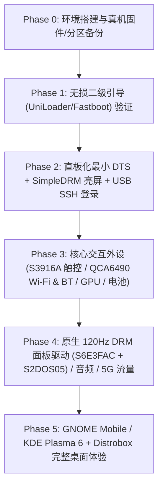

# Samsung Galaxy Z Flip 5 (`SM-F7310` / 直板改装版) postmarketOS 移植实施计划

本实施计划针对 **Apple A18 Pro Mac 宿主机** + **已解锁且已 Root 的 512GB `SM-F7310` 直板改装机** 量身定制，采用 **“零砖机风险（RAM 启动优先）、从简到繁、直板固化”** 的工程路线。

---

## 总体路线图

---

## Phase 0：协同开发环境搭建与安全基线备份（✅ 已完成）

### 0.1 解决宿主机磁盘空间与大小写敏感限制
- [x] **大小写敏感构建卷**：已创建并挂载动态稀疏卷 `build/pmos_case_sensitive.sparseimage` 至 `build/case_sensitive_ws`（`APFS (Case-sensitive)`），仅按实际写入占用空间，满足主线 Linux 内核源码检出要求。
- [x] **本地工程工具链就绪**：
  - `platform-tools/adb` & `platform-tools/fastboot`
  - `tools/dtc` (Device Tree Compiler v1.8.1)
  - [`tools/mkbootimg_v2.py`](../tools/mkbootimg_v2.py)（针对 `SM-F7310` `recovery` 分区定制的 Android Boot Image v2 打包器）
  - [`scripts/restore_stock_partitions.sh`](../scripts/restore_stock_partitions.sh)（带 SHA256 校验的一键原厂分区恢复脚本）
  - [`scripts/extract_key_dts_nodes.py`](../scripts/extract_key_dts_nodes.py)（关键外设 DTS 节点提取脚本，产物见 [`extracted_hw_info/key_nodes_extracted.dts`](../extracted_hw_info/key_nodes_extracted.dts)）

### 0.2 真机关键分区与专有固件提取备份（通过 Root ADB）
- [x] **15 个核心分区三端备份**（已保存于手机 `/data/local/linux_port/backups/`、`/sdcard/backup_b5q/` 及宿主机 `backups/backup_b5q/`，校验和见 [`extracted_hw_info/BACKUP_SHA256SUMS.txt`](../extracted_hw_info/BACKUP_SHA256SUMS.txt)）：
  - 引导与内核链：`boot.img` (96M)、`init_boot.img` (8M)、`vendor_boot.img` (96M)、`recovery.img` (105M)、`dtbo.img` (16M)、`vbmeta.img` (128K)、`vbmeta_system.img` (64K)、`abl.img` (4M)、`param.img` (10M)
  - 基带与校准数据：`efs.img` (20M)、`sec_efs.img` (20M)、`modemst1.img` (3M)、`modemst2.img` (3M)、`fsg.img` (3M)、`fsc.img` (4K)
- [x] **专有固件包提取 (`firmware-samsung-b5q.tar.gz`，23 MB)**：
  - 已按主线 Linux `/lib/firmware/` 标准目录结构整理并归档至手机与宿主机 `backups/backup_b5q/firmware-samsung-b5q.tar.gz`，包含 Adreno 740 (`a740_sqe.fw`, `gmu_gen70200.bin`)、Wi-Fi 6E (`ath11k/WCN6855/hw2.1/*`)、蓝牙 (`qca/hpbtfw21.tlv`, `hpnv21*`)、主屏触控 (`tsp_synaptics/s3916a_b5.bin`)、音频/震动 (`tfa98xx.cnt`, `cs40l26*`) 及 ADSP/CDSP/Modem 固件。
- [x] **关键引导镜像头解析（重大发现，见 [`extracted_hw_info/boot_images_layout.txt`](../extracted_hw_info/boot_images_layout.txt)）**：
  - `boot.img` 为 GKI v4 格式（需配合 `init_boot` + `vendor_boot` + `dtbo` 四分区联动）；
  - **`recovery.img` (`/dev/block/sda23`, 104.5 MB) 为完全独立的 Android Boot Image Header v2 格式**（`Page Size: 4096`, `Kernel Addr: 0x00008000`, `Ramdisk Addr: 0x02000000`, `Tags Addr: 0x01e00000`, `DTB Addr: 0x01f00000`, `Board: SRPWC09A007`），**单个镜像内同时包含独立的 Kernel + Ramdisk + DTB + Cmdline**！
  - **直接工程收益**：我们可以保持原厂 `boot` 与 `vendor_boot` 分区 **100% 原封不动**，仅将 UniLoader 或主线 Linux 打包为 Header v2 镜像刷入独立的 `recovery` 分区。通过 `adb reboot recovery` 即可引导主线 Linux / UniLoader，任何时候普通重启均可直接回到日常 Android 14 系统。

---

## Phase 1：无损二级引导链路搭建（告别反复 Odin 刷机）

三星原厂 Bootloader (ABL) 仅提供 Odin Download Mode，不支持 `fastboot boot` 内存加载测试内核。直接反复刷写 `boot` 分区既慢又容易磨损闪存。

### 1.1 部署 UniLoader（或 Fastboot 二级 Bootloader）
1. **原理**：将针对 `sm8550` / `samsung-b5q` 编译的 **UniLoader** 打包为 Android `boot.img` 格式刷入手机 `boot` 分区（或刷入 `recovery` 分区，通过按键组合进入）。
2. **收益**：
   - 手机开机进入 UniLoader 后，会在 USB 接口暴露标准的 **Fastboot 协议**；
   - 在 Mac 上直接执行 `./platform-tools/fastboot boot zImage-dtb initramfs.cpio.gz`，即可**将主线 Linux 内核加载到内存中单次运行**；
   - 一旦主线内核崩溃或断电重启，手机无需重刷即可安全回退，实现 **100% 零风险调试**。

---

## Phase 2：直板化最小设备树 (`sm8550-samsung-b5q.dts`) 与首次启动

基于 `linux-postmarketos-qcom-sm8550` 内核树（Linux 6.12+），编写直板化专用的 `sm8550-samsung-b5q.dts`。

### 2.1 最小启动 DTS 核心配置
1. **基础平台引用**：
   - `#include "sm8550.dtsi"` 及高通 PMIC 头文件（`pm8550.dtsi`, `pm8550ve.dtsi`, `pm8550vs.dtsi`, `pmk8550.dtsi`, `pmr735d.dtsi`）。
   - 同步 [`extracted_hw_info/fdt.dts`](../extracted_hw_info/fdt.dts) 中的 `/reserved-memory` 布局，防止内核踩踏 TrustZone / Gunyah / XBL 内存区导致硬重启。
2. **直板化裁剪**：
   - **不添加**任何副屏 (`DSI-2`)、副屏 SPI 触控 (`spi@890000`) 和霍尔传感器 (`i2c@a8c000` `akm@10`) 节点。
3. **早期屏幕输出 (`simple-framebuffer`)**：
   - 在 `/chosen` 节点下声明 `framebuffer@b8000000`：
     - `reg = <0x0 0xb8000000 0x0 0x2b00000>;`
     - `width = <1080>; height = <2640>; stride = <(1080 * 4)>; format = "a8r8g8b8";`
   - 保持 `S2DOS05` 及显示相关 RPMh 供电轨开启 (`regulator-always-on` / `regulator-boot-on`)，确保 ABL 点亮的屏幕在进入主线内核后不掉电。
4. **USB Gadget 网络与 SSH 调试通道**：
   - 启用 `usb_1` (`dwc3@a600000`) 并强制设为 `dr_mode = "peripheral"`；
   - 通过 postmarketOS `initramfs` 启动 USB NCM/RNDIS 网卡 (`172.16.42.1`)，从 Mac 直接 `ssh user@172.16.42.1` 登录手机主线 Linux 终端。

### 2.2 里程碑验收标准 (M1 & M2) — ✅ Phase 2 全部完成！
- [x] **主线 Linux 7.3.5 首次在直板 Z Flip 5 (`SM-F7310`) 上成功启动至 PID 1 `/init`**（通过独立 104.5 MB `recovery` 分区 Header v2 镜像，原生 8 核骁龙 8 Gen 2 编译，零修改日常 Android 14 启动链）；
- [x] **主屏实时显示高清大字体 (`TER16x32`) 启动日志与欢迎页**（`1080×2640` `framebuffer@b8000000` + `cont_splash: splash_region@b8000000` + 50 路 RPMh 供电保活 + `initcall_blacklist=msg_init,of_platform_sync_state_init,icc_sync_state,regulator_init_complete` 彻底解决 SM8550 NoC 冻屏）；
- [x] **USB 控制器 (`dwc3-qcom a600000.usb` + `usb_dp_qmpphy` PIPE 时钟) 与 macOS 免驱 USB CDC-NCM 网卡彻底打通**：Mac 原生识别为 `Hardware Port: Z Flip 5 Mainline Linux (b5q)` (`en5`)，实现 **Mac 免密 `root` SSH 直连**（一键脚本 [`scripts/ssh_b5q.sh`](../scripts/ssh_b5q.sh)）；
- [x] **512 GB UFS 4.0 闪存 (`sda1`~`sda36`, `475.9G`) 完整在线**，且 `/init` 启动时自动清除 `/dev/sda10` (`misc`) 的 `boot-recovery` 标志（随时 `reboot` 无缝回到 Android 14，无需再进 Download Mode）；
- [x] **全部 8 核 CPU、6.8 GB RAM 与 3 颗物理按键** (`pmic_pwrkey`、`pmic_resin`、`gpio-keys`) 实测工作正常。

---

## Phase 3：核心交互外设与无线网络调通

在 SSH 终端可用的基础上，逐个点亮日常交互必需的核心外设：

### 3.1 主屏触控 (`Synaptics S3916A`)
- **DTS 节点**：在 `&qupv3_se4_i2c` (`i2c@a90000`) 下配置 `touchscreen@20`：
  - 驱动兼容：`synaptics,tcm-i2c`
  - 中断：`<&tlmm 19 IRQ_TYPE_EDGE_FALLING>`
  - 配置 3.3V AVDD 与 1.8V IOVDD 供电轨（对照 `fdt.dts` 中的 `tsp_io_ldo-supply` 与 `tsp_avdd_ldo-supply`）。
- **验收**：`libinput debug-events` 可连续捕获单指滑动与多点触控坐标 (`1080×2640`)。

### 3.2 UFS 4.0 存储与 Rootfs 落盘
- 启用 `&ufs_mem_hc` 与 `&ufs_mem_phy`，挂载手机内部 UFS 分区；
- 将 postmarketOS Rootfs 镜像安装至 `/data` 下的镜像文件（Loop 挂载）或独立 userdata 子分区，实现脱离内存盘的高速启动。

### 3.3 GPU 3D 硬件加速 (`Adreno 740`)
- 启用 `&gpu` (`adreno 740`) 与 `&gmu`，放入本机提取的 `a740_sqe.fw` 与 `gmu_gen70200.bin`；
- 验证 Mesa `Freedreno` (`glxinfo` / `eglinfo`) 与 `Turnip` (`vulkaninfo`) 硬件渲染正常。

### 3.4 Wi-Fi 6E & 蓝牙 5.3 (`QCA6490 / WCN6855`)
- **Wi-Fi**：配置 PCIe0 (`&pcie0`) 与电源使能引脚，将本机 `/vendor/firmware/qca6490/` 固件部署至 `/lib/firmware/ath11k/WCN6855/hw2.1/`，加载 `ath11k_pci` 驱动连接 Wi-Fi。
- **蓝牙**：配置對應 QUP UART 节点 (`bluetooth` / `qcom,wcn6855-bt`)，部署 `hpbtfw21.tlv` 与 `hpnv21.bin`，通过 `bluetoothctl` 连接蓝牙键鼠与蓝牙耳机。

### 3.5 电池电量、充电与震动 (`Maxim MAX77705`)
- 在对应 I2C 总线配置 `max77705@66`（中断 `TLMM GPIO 133`），启用主线 `max77705` MFD、Fuel Gauge、Charger 及 Haptic 子节点；
- 验证 `/sys/class/power_supply/` 下能正确上报电池电压、电流与电量百分比，插拔充电器状态正常切换。

---

## Phase 4：原生 120Hz DRM 面板驱动、音频与 5G 移动网络

### 4.1 主屏原生 DRM Panel 驱动 (`S6E3FAC` + `S2DOS05`)
1. 在 I2C 总线配置 `s2dos05@60` PMIC 节点，接管面板 VCI / VDD3 / ELVDD / ELVSS 供电轨；
2. 从 [`extracted_hw_info/fdt.dts`](../extracted_hw_info/fdt.dts) 中提取 `B5_S6E3FAC_AMF670BS03` 的 MIPI DSI 初始化与休眠指令流，编写 `panel-samsung-s6e3fac.c`；
3. 从 `SimpleDRM` 切换到完整的 `msm_dpu` + `dsi0` 原生显示管线，实现 **120Hz 高刷新率**、**亮度无级调节** 以及 **锁屏彻底关闭屏幕电源省电**。

### 4.2 音频外放 (`WCD938x` + 双 `TFA9878`) 与 5G 基带
1. 配置 ADSP/CDSP `remoteproc`，启用 `pd-mapper` 与 `tqftpserv`；
2. 配置 SoundWire `WCD938x` 及 I2C Bus 18 上的双 `TFA9878` (`0x34`, `0x35`) 功放，编写 ALSA UCM 路由文件，打通机身扬声器与麦克风；
3. 配置 `mpss` 远程处理器与 `rmtfs` 服务，通过 `ModemManager` 打通 5G/4G 移动数据流量与 GPS。

---

## Phase 5：桌面融合体验与生产力环境定型

1. **桌面环境部署**：
   - 使用 `pmbootstrap` 构建带有 **`systemd`** 的 **`postmarketOS edge`** 镜像；
   - 预装 **`postmarketos-ui-gnome-mobile`**（完整版桌面 GNOME + 移动端自适应触控手势补丁）或 **`KDE Plasma 6`**（支持 `Plasma Mobile` 与 `Plasma Desktop` 一键切换）。
2. **完整桌面软件生态 (`Flatpak` + `Distrobox`)**：
   - 配置 `Flatpak` 获取主流 ARM64 Linux 桌面 GUI 应用；
   - 部署 `Distrobox`（搭载 **Arch Linux ARM** 或 **Ubuntu ARM64** 容器），使得任何依赖 `glibc` 的桌面软件、开发编译工具链、VS Code 甚至 `Box64` / `FEX-Emu` 都能以原生 Wayland 窗口无缝运行。
