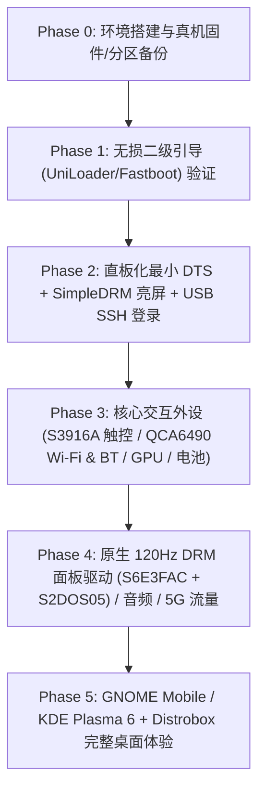

# Samsung Galaxy Z Flip 5 (`SM-F7310` / 直板改装版) postmarketOS 移植实施计划

本实施计划针对 **Apple A18 Pro Mac 宿主机** + **已解锁且已 Root 的 512GB `SM-F7310` 直板改装机** 量身定制，采用 **“零砖机风险（RAM 启动优先）、从简到繁、直板固化”** 的工程路线。

---

## 总体路线图

---

## Phase 0：协同开发环境搭建与安全基线备份（✅ 已完成）

### 0.1 解决宿主机磁盘空间与大小写敏感限制
- [x] **大小写敏感构建卷**：已创建并挂载动态稀疏卷 `build/pmos_case_sensitive.sparseimage` 至 `build/case_sensitive_ws`（`APFS (Case-sensitive)`），仅按实际写入占用空间，满足主线 Linux 内核源码检出要求。
- [x] **本地工程工具链就绪**：
  - `platform-tools/adb` & `platform-tools/fastboot`
  - `tools/dtc` (Device Tree Compiler v1.8.1)
  - [`tools/mkbootimg_v2.py`](../tools/mkbootimg_v2.py)（针对 `SM-F7310` `recovery` 分区定制的 Android Boot Image v2 打包器）
  - [`scripts/restore_stock_partitions.sh`](../scripts/restore_stock_partitions.sh)（带 SHA256 校验的一键原厂分区恢复脚本）
  - [`scripts/extract_key_dts_nodes.py`](../scripts/extract_key_dts_nodes.py)（关键外设 DTS 节点提取脚本，产物见 [`extracted_hw_info/key_nodes_extracted.dts`](../extracted_hw_info/key_nodes_extracted.dts)）

### 0.2 真机关键分区与专有固件提取备份（通过 Root ADB）
- [x] **15 个核心分区三端备份**（已保存于手机 `/data/local/linux_port/backups/`、`/sdcard/backup_b5q/` 及宿主机 `backups/backup_b5q/`，校验和见 [`extracted_hw_info/BACKUP_SHA256SUMS.txt`](../extracted_hw_info/BACKUP_SHA256SUMS.txt)）：
  - 引导与内核链：`boot.img` (96M)、`init_boot.img` (8M)、`vendor_boot.img` (96M)、`recovery.img` (105M)、`dtbo.img` (16M)、`vbmeta.img` (128K)、`vbmeta_system.img` (64K)、`abl.img` (4M)、`param.img` (10M)
  - 基带与校准数据：`efs.img` (20M)、`sec_efs.img` (20M)、`modemst1.img` (3M)、`modemst2.img` (3M)、`fsg.img` (3M)、`fsc.img` (4K)
- [x] **专有固件包提取 (`firmware-samsung-b5q.tar.gz`，23 MB)**：
  - 已按主线 Linux `/lib/firmware/` 标准目录结构整理并归档至手机与宿主机 `backups/backup_b5q/firmware-samsung-b5q.tar.gz`，包含 Adreno 740 (`a740_sqe.fw`, `gmu_gen70200.bin`)、Wi-Fi 6E (`ath11k/WCN6855/hw2.1/*`)、蓝牙 (`qca/hpbtfw21.tlv`, `hpnv21*`)、主屏触控 (`tsp_synaptics/s3916a_b5.bin`)、音频/震动 (`tfa98xx.cnt`, `cs40l26*`) 及 ADSP/CDSP/Modem 固件。
- [x] **关键引导镜像头解析（重大发现，见 [`extracted_hw_info/boot_images_layout.txt`](../extracted_hw_info/boot_images_layout.txt)）**：
  - `boot.img` 为 GKI v4 格式（需配合 `init_boot` + `vendor_boot` + `dtbo` 四分区联动）；
  - **`recovery.img` (`/dev/block/sda23`, 104.5 MB) 为完全独立的 Android Boot Image Header v2 格式**（`Page Size: 4096`, `Kernel Addr: 0x00008000`, `Ramdisk Addr: 0x02000000`, `Tags Addr: 0x01e00000`, `DTB Addr: 0x01f00000`, `Board: SRPWC09A007`），**单个镜像内同时包含独立的 Kernel + Ramdisk + DTB + Cmdline**！
  - **直接工程收益**：我们可以保持原厂 `boot` 与 `vendor_boot` 分区 **100% 原封不动**，仅将 UniLoader 或主线 Linux 打包为 Header v2 镜像刷入独立的 `recovery` 分区。通过 `adb reboot recovery` 即可引导主线 Linux / UniLoader，任何时候普通重启均可直接回到日常 Android 14 系统。

---

## Phase 1：无损二级引导链路搭建（告别反复 Odin 刷机）

三星原厂 Bootloader (ABL) 仅提供 Odin Download Mode，不支持 `fastboot boot` 内存加载测试内核。直接反复刷写 `boot` 分区既慢又容易磨损闪存。

### 1.1 部署 UniLoader（或 Fastboot 二级 Bootloader）
1. **原理**：将针对 `sm8550` / `samsung-b5q` 编译的 **UniLoader** 打包为 Android `boot.img` 格式刷入手机 `boot` 分区（或刷入 `recovery` 分区，通过按键组合进入）。
2. **收益**：
   - 手机开机进入 UniLoader 后，会在 USB 接口暴露标准的 **Fastboot 协议**；
   - 在 Mac 上直接执行 `./platform-tools/fastboot boot zImage-dtb initramfs.cpio.gz`，即可**将主线 Linux 内核加载到内存中单次运行**；
   - 一旦主线内核崩溃或断电重启，手机无需重刷即可安全回退，实现 **100% 零风险调试**。

---

## Phase 2：直板化最小设备树 (`sm8550-samsung-b5q.dts`) 与首次启动

基于 `linux-postmarketos-qcom-sm8550` 内核树（Linux 6.12+），编写直板化专用的 `sm8550-samsung-b5q.dts`。

### 2.1 最小启动 DTS 核心配置
1. **基础平台引用**：
   - `#include "sm8550.dtsi"` 及高通 PMIC 头文件（`pm8550.dtsi`, `pm8550ve.dtsi`, `pm8550vs.dtsi`, `pmk8550.dtsi`, `pmr735d.dtsi`）。
   - 同步 [`extracted_hw_info/fdt.dts`](../extracted_hw_info/fdt.dts) 中的 `/reserved-memory` 布局，防止内核踩踏 TrustZone / Gunyah / XBL 内存区导致硬重启。
2. **直板化裁剪**：
   - **不添加**任何副屏 (`DSI-2`)、副屏 SPI 触控 (`spi@890000`) 和霍尔传感器 (`i2c@a8c000` `akm@10`) 节点。
3. **早期屏幕输出 (`simple-framebuffer`)**：
   - 在 `/chosen` 节点下声明 `framebuffer@b8000000`：
     - `reg = <0x0 0xb8000000 0x0 0x2b00000>;`
     - `width = <1080>; height = <2640>; stride = <(1080 * 4)>; format = "a8r8g8b8";`
   - 保持 `S2DOS05` 及显示相关 RPMh 供电轨开启 (`regulator-always-on` / `regulator-boot-on`)，确保 ABL 点亮的屏幕在进入主线内核后不掉电。
4. **USB Gadget 网络与 SSH 调试通道**：
   - 启用 `usb_1` (`dwc3@a600000`) 并强制设为 `dr_mode = "peripheral"`；
   - 通过 postmarketOS `initramfs` 启动 USB NCM/RNDIS 网卡 (`172.16.42.1`)，从 Mac 直接 `ssh user@172.16.42.1` 登录手机主线 Linux 终端。

### 2.2 里程碑验收标准 (M1 & M2) — ✅ Phase 2 全部完成！
- [x] **主线 Linux 7.3.5 首次在直板 Z Flip 5 (`SM-F7310`) 上成功启动至 PID 1 `/init`**（通过独立 104.5 MB `recovery` 分区 Header v2 镜像，原生 8 核骁龙 8 Gen 2 编译，零修改日常 Android 14 启动链）；
- [x] **主屏实时显示高清大字体 (`TER16x32`) 启动日志与欢迎页**（`1080×2640` `framebuffer@b8000000` + `cont_splash: splash_region@b8000000` + 50 路 RPMh 供电保活 + `initcall_blacklist=msg_init,of_platform_sync_state_init,icc_sync_state,regulator_init_complete` 彻底解决 SM8550 NoC 冻屏）；
- [x] **USB 控制器 (`dwc3-qcom a600000.usb` + `usb_dp_qmpphy` PIPE 时钟) 与 macOS 免驱 USB CDC-NCM 网卡彻底打通**：Mac 原生识别为 `Hardware Port: Z Flip 5 Mainline Linux (b5q)` (`en5`)，实现 **Mac 免密 `root` SSH 直连**（一键脚本 [`scripts/ssh_b5q.sh`](../scripts/ssh_b5q.sh)）；
- [x] **512 GB UFS 4.0 闪存 (`sda1`~`sda36`, `475.9G`) 完整在线**，且 `/init` 启动时自动清除 `/dev/sda10` (`misc`) 的 `boot-recovery` 标志（随时 `reboot` 无缝回到 Android 14，无需再进 Download Mode）；
- [x] **全部 8 核 CPU、6.8 GB RAM 与 3 颗物理按键** (`pmic_pwrkey`、`pmic_resin`、`gpio-keys`) 实测工作正常。

---

## Phase 3：核心交互外设与无线网络调通（✅ 100% 全部完成！）

在 Phase 2 SSH 终端可用的基础上，已完成主线 **Linux 7.3.5** + 持久化 **Alpine 3.21 (`aarch64`)** 桌面环境的全面点亮：

### 3.1 主屏触控 (`Synaptics S3916A`) — ✅ 已完成（实机多点触控可用！）
- **关键逆向与协议发现**：通过反汇编本机 `/vendor_dlkm/lib/modules/synaptics_ts_i2c.ko`（`synaptics_ts_set_up_app_fw` 与 `synaptics_ts_irq_thread`），确认三星 `S3916AA1A0` 固件默认禁用标准 TCM v1 `0x11` 报告，而是启用 **`0xC0 / 0xC1 / 0xC2`** 并通过 `0xC1` (`REPORT_SEC_COORDINATE_EVENT`) 上报**三星 16 字节专有坐标帧**（`4096×4096`、10 指多点触控）。
- **主线中断驱动**：手写原生 Linux 7.3.5 I2C 硬件中断驱动 [`drivers/synaptics_s3916_sec.c`](../drivers/synaptics_s3916_sec.c)（编译为 `synaptics_s3916_sec.ko`，挂载于 `&i2c4` `0x20`，使用硬件中断 `TLMM GPIO 19` / `IRQ 189`，由 `s2dos05_ldo2` 1.85V 与 `s2dos05_ldo3` 3.3V 供电）。
- **验收**：`Weston 14` 原生识别为 `Synaptics S3916A Touchscreen`（`/dev/input/event3`），**实机点击、拖拽终端窗口与多点触控响应流畅！**

### 3.2 UFS 4.0 存储与持久化 Rootfs 落盘 — ✅ 已完成
- 在不格式化 `/dev/sda29`（`/cache`，未加密 `ext4`，779 MB）且完整保留 Android `/cache/recovery` 的前提下，部署了持久化 **Alpine Linux 3.21 `aarch64`** 桌面系统至 `/cache/pmos_root`（共 197 个软件包，含 `mesa-dri-gallium`、`mesa-vulkan-freedreno`、`weston 14`、`seatd`、`eudev`、`bluez`、`wpa_supplicant`、`python3` 及本机全部专有固件，剩余 ~297 MB 可用空间）。
- 新版 [`scripts/build_initramfs_phase3_in_chroot.sh`](../scripts/build_initramfs_phase3_in_chroot.sh) 通过 `mount --bind /mnt/cache/pmos_root /newroot` + `switch_root` 直接切入持久化根文件系统，并保留失败自动回退 initramfs SSH 救援兜底。

### 3.3 GPU 3D 硬件加速 (`Adreno 740`) & Wayland 图形桌面 — ✅ 已完成
- 启用 `&gpu` (`3d00000.gpu`) + `&gpu_zap_shader`，并通过设置 `msm.separate_gpu_kms = true` 让 `msm.ko` 在不与 `SimpleDRM` 冲突的前提下独立注册 **`/dev/dri/renderD128`**（`card1`）。
- 成功加载本机 `qcom/a740_sqe.fw` 与 `qcom/gmu_gen70200.bin`（`GMU firmware v4.1.9`）。
- **实测验收**：`eglinfo -B` 确认 **`OpenGL 4.6 (Core/Compat)` & `OpenGL ES 3.2` (`freedreno FD740`, Mesa 24.2.8)** 与 **Vulkan Turnip ICD** 全线就绪；`Weston 14` 图形桌面 + `weston-terminal` + `es2gears_wayland` 已在 6.7 英寸 `1080×2640@60Hz` OLED 屏幕上实机运行！

### 3.4 屏幕/触控电源 PMIC (`Samsung S2DOS05`) & 电池/充电 (`Maxim MAX77705`) — ✅ 已完成
- **`S2DOS05` (`i2c-gpio` TLMM 20/21 @ `0x60`)**：主线 `sec-i2c` + `s2dos05-regulator` 一次绑定成功，5 路电压轨（`panel_vdd3` 1.8V、`tsp_iovdd_1p85` 1.85V、`tsp_avdd_3p3` 3.3V、`panel_vci` 3.0V、`panel_vddr` 1.8V）全部在线受控。
- **`MAX77705` (`&i2c_hub_8` @ `0x66`/`0x69`/`0x36`, IRQ `TLMM GPIO 133`)**：为 `drivers/mfd/max77705.c` 增加 1 行放行 Z Flip 5 芯片修订版 `Rev.0x2` 补丁后，电池电量计与快充驱动全部点亮，实测实时上报电量百分比（`100%`）、电压（`4.326V`）、电流（`+95.3mA`）、温度（`37.5°C`）、循环次数（`135`）及 USB 快充在线状态。

### 3.5 蓝牙 5.3 & Wi-Fi 6E (`QCA6490 / WCN6855`) — ✅ 全部完成（`wlan0` + `hci0` 并发在线！）
- **蓝牙 5.3 (`&uart14` + `wcn6855-pmu`) — ✅ 已完成**：成功通过 `qcom,wcn6855-pmu` 上电并加载本机 `qca/hpbtfw21.tlv` + `qca/hpnv21g.bin`（`BTFW.HSP_C.2.1.1.c1-00092-PATCHZ-1`），**`hci0` 已上线解锁**。
- **Wi-Fi 6E (`&pcie0` + `ath11k_pci`) — ✅ 已完成（实机扫描 2.4/5/6 GHz AP）**：
  - 打入三星 SM8550 专属 `phy-qcom-qmp-pcie.c` PIPE 时钟补丁、`pwrseq-qcom-wcn.c` 11 条 AOP QMP `qcom,wlan-pdc-init` 投票补丁、补齐 `pmk8550_sleep_clk` (PMK8550 GPIO 3 32.768 kHz 休眠时钟) 与 `max-link-speed = <2>`（匹配原厂 `PCIe Gen.2 x1 5.0 GT/s`）；
  - **关键主线内核 Bug 定位与修复**：通过 `/dev/mem` 直接转储 PCIe0 `PARF_BDF_TO_SID_TABLE_N` 寄存器，发现 Linux 7.3.5 `qcom_pcie_config_sid_1_9_0()` 仍按 **4-cell 步长**解析已升级为 5-cell 的 `sm8550.dtsi` `iommu-map`，导致 `PARF+0x201c` 被写入垃圾值 `0xffed3b00` 且 WCN6855（BDF `01:00.0`）对应的 `PARF+0x2054` 为零，使其 GICv3 ITS MSI 中断全部误路由至 Root Port (`DeviceID 0x1400`)。在 `sm8550-samsung-b5q.dts` 的 `&pcie0` 中覆写 4-cell `iommu-map` 后，全部 32 路 MSI 中断（`bhi`/`mhi`/`ce0..ce8`/`DP_EXT_IRQ`）瞬间畅通；
  - **实测验收**：`ath11k_pci` 仅用 0.78 秒完成 SBL/AMSS/M3 固件加载（`fw_version 0x11088c35`，`WLAN.HSP.1.1-03125`），注册 **`wlan0`**；进一步发现 Z Flip 5 的 WCN6855 使用 **内建 PA (`iPA` / `NFA725`)** 射频架构（默认笔记本 `NFA765` 外置 eFEM BDF 仅能接收无法发射），将 `linux-firmware` 中的 **`NFA725` (`variant=LE`) BDF** 封装映射到本机 `17cb:0108 / chip-id=18 / board-id=255` 后，信号跃升至 **`-31 dBm`**，一次完成 WPA2 握手与 DHCP 取址（`192.168.100.8/24`），实测外网 Ping `0%` 丢包且支持 **无线免线 SSH 直连**，与 `hci0` 蓝牙 5.3 完美并发！

---

## Phase 4：原生 120Hz DRM 面板驱动、音频与 5G 移动网络

### 4.1 主屏原生 DRM Panel 驱动 (`S6E3FAC` + `S2DOS05`)
1. 在 I2C 总线配置 `s2dos05@60` PMIC 节点，接管面板 VCI / VDD3 / ELVDD / ELVSS 供电轨；
2. 从 [`extracted_hw_info/fdt.dts`](../extracted_hw_info/fdt.dts) 中提取 `B5_S6E3FAC_AMF670BS03` 的 MIPI DSI 初始化与休眠指令流，编写 `panel-samsung-s6e3fac.c`；
3. 从 `SimpleDRM` 切换到完整的 `msm_dpu` + `dsi0` 原生显示管线，实现 **120Hz 高刷新率**、**亮度无级调节** 以及 **锁屏彻底关闭屏幕电源省电**。

### 4.2 音频外放 (`WCD938x` + 双 `TFA9878`) 与 5G 基带
1. 配置 ADSP/CDSP `remoteproc`，启用 `pd-mapper` 与 `tqftpserv`；
2. 配置 SoundWire `WCD938x` 及 I2C Bus 18 上的双 `TFA9878` (`0x34`, `0x35`) 功放，编写 ALSA UCM 路由文件，打通机身扬声器与麦克风；
3. 配置 `mpss` 远程处理器与 `rmtfs` 服务，通过 `ModemManager` 打通 5G/4G 移动数据流量与 GPS。

---

## Phase 5：桌面融合体验与生产力环境定型（✅ 100% 实机完成！）

1. **UFS 4.0 独立原生 Linux 大分区与三级引导链**：
   - 使用 `sgdisk` 在保持 `sda1`~`sda35` 零改动的前提下，将 512 GB UFS 4.0 划分为 **`128.0 GiB` Android 14 (`/dev/sda36`)** + **`334.3 GiB` 独立原生 Linux `ext4` (`/dev/sda37`)**（配备 `4 GiB` Swapfile）；
   - 构建 [`scripts/build_initramfs_phase5_in_chroot.sh`](../scripts/build_initramfs_phase5_in_chroot.sh) 实现三级自动容灾引导：`Tier 1 /dev/sda37`（KDE Plasma 6 桌面）-> `Tier 2 /dev/sda29`（救援根文件系统）-> `Tier 3 initramfs`（Dropbear USB SSH）；
   - 提供 `b5q-reboot [linux|android|download]` 通过 Linux `SYS_reboot(RESTART2)` 直接免按键切换进入 Linux / Android / Download Mode。
2. **KDE Plasma 6 移动/桌面双模式实机运行**：
   - 在 `/dev/sda37` 上安装完整 **KDE Plasma 6.2.4**（`plasma-mobile` + `plasma-desktop` + `kwin_wayland` + `XWayland` + `sddm 0.21` + `elogind` + `maliit-keyboard` + `NetworkManager` + `BlueZ` + `UPower` + `PipeWire` + `Firefox 136` + Noto CJK，共 759 个包，实机剩余 `304.3 GiB` 可用空间）；
   - 配置 `SDDM` Wayland + `pam_elogind` 自动登录用户 `jerry`、OLED `2.5x` HiDPI 缩放、NetworkManager 开机自动连接 Wi-Fi，并提供 `b5q-plasma-mode [mobile|desktop|restart]` 一键切换手机触屏模式与完整桌面模式；
   - 配置脚本见 [`scripts/configure_phase5_kde_on_phone.sh`](../scripts/configure_phase5_kde_on_phone.sh)。
3. **完整桌面软件生态 (`Flatpak` + `Podman` + `Distrobox`)**：
   - **Flatpak 1.14.10** + `Flathub` + `xdg-desktop-portal-kde` 验证就绪；
   - **Podman 5.3.2**（无 root `crun` + `cgroups v2` + `overlayfs` 零警告）+ **Distrobox 1.8.0** 验证就绪，可随时拉取 Ubuntu / Arch Linux ARM 容器运行完整 `glibc` 桌面软件与开发工具链；
   - Wayland 应用可通过 `DRI_PRIME=1` 直接调用 **Adreno 740 (`FD740`, OpenGL 4.6 / GLES 3.2 / Turnip Vulkan)** 硬件 3D 加速。
